<div align="center">

# DentaCare Türkiye

### Sağlıklı gülüşler için tasarlanmış bir mobil deneyim.

Hekimleri keşfet. Randevunu planla. Bakımını takip et.

**PREMIUM STUDIO 3.0 · TÜRKÇE ARAYÜZ · ETKİLEŞİMLİ DEMO**

[Galeriyi incele](#ekran-galerisi) · [Projeyi çalıştır](#kurulum--windows--vs-code) · [Teknik belgeler](#teknik-belgeler)

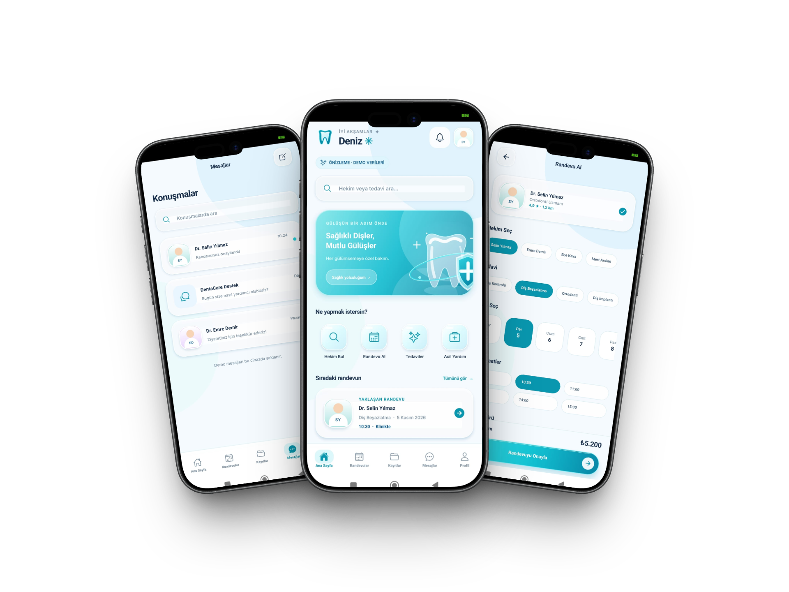

**Expo SDK 57 · React Native · Expo Router · TypeScript**

</div>

## Deneyim

DentaCare Türkiye, diş sağlığı uygulamalarındaki keşif, kişiselleştirme ve randevu akışlarını bir araya getiren bir mobil arayüz demosudur. Buz mavisi yüzeyler, turkuaz geçişler ve cam efektli kartlar; Türkçe içerik ve tutarlı bileşenlerle birleşir.

| Akış | Demoda sunulan deneyim |
| --- | --- |
| Sana özel başlangıç | Bakım ihtiyaçları, görüşme tercihi ve bildirim seçenekleri |
| Hekim ve tedavi keşfi | Örnek hekim profilleri, tedavi seçenekleri ve favoriler |
| Randevu planlama | Hekim, tedavi, tarih ve saat seçimi; yerel randevu yönetimi |
| Sağlık kayıtları | Örnek görüntüleme, reçete, tedavi planı ve belge ekranları |
| İletişim | Demo konuşmalar, sohbet ve görüntülü görüşme arayüzü |
| Hesap ve tercihler | Profil, bildirimler, ödeme ve tasarım sistemi ekranları |

> **Proje durumu:** Etkileşimli ön yüz demosu. Klinik sistemleri, gerçek ödeme ve canlı görüşme servisleri bağlı değildir.

## Ekran galerisi

Ana akıştan seçilen ekranlar. Görselleri tam boy açmak için üzerlerine tıklayın.

<table>
  <tr>
    <th align="center">İlk izlenim</th>
    <th align="center">Ana sayfa</th>
    <th align="center">Randevu al</th>
  </tr>
  <tr>
    <td align="center"><a href="docs/images/hos-geldin.jpg">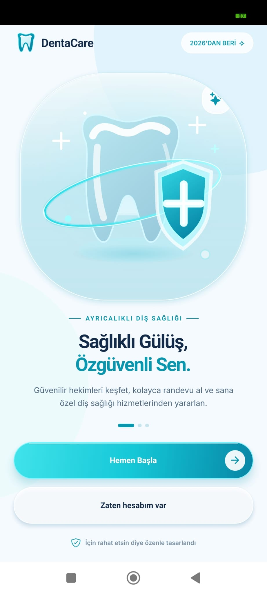</a></td>
    <td align="center"><a href="docs/images/ana-sayfa.jpg"></a></td>
    <td align="center"><a href="docs/images/randevu-al.jpg"></a></td>
  </tr>
  <tr>
    <td align="center">Marka ve karşılama</td>
    <td align="center">Keşif ve hızlı erişim</td>
    <td align="center">Tarih ve saat seçimi</td>
  </tr>
</table>

<table>
  <tr>
    <th align="center">Randevularım</th>
    <th align="center">Sağlık kayıtları</th>
    <th align="center">Mesajlar</th>
  </tr>
  <tr>
    <td align="center"><a href="docs/images/yaklasan-randevular.jpg"></a></td>
    <td align="center"><a href="docs/images/saglik-kayitlari.jpg">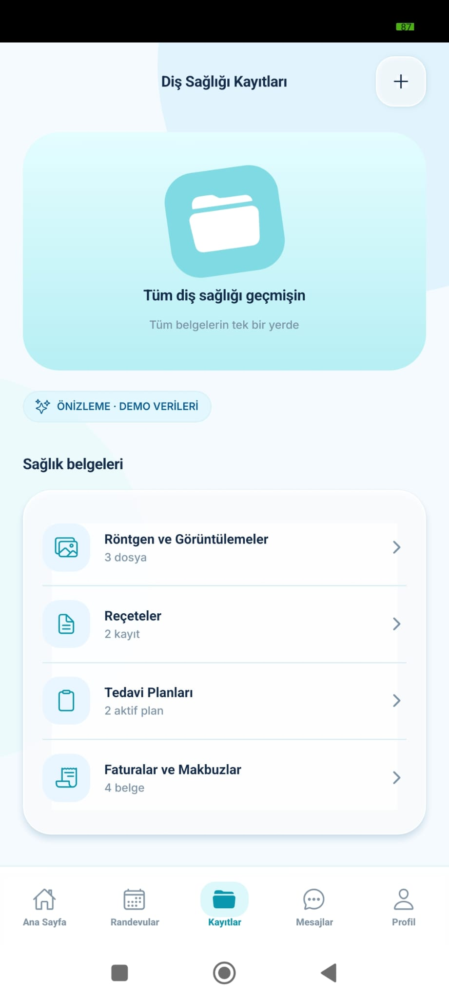</a></td>
    <td align="center"><a href="docs/images/mesajlar.jpg">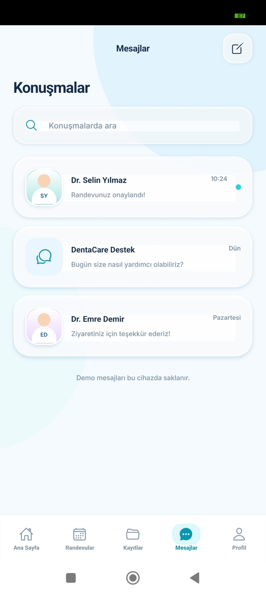</a></td>
  </tr>
  <tr>
    <td align="center">Yaklaşan ziyaretler</td>
    <td align="center">Belgeler ve tedavi planları</td>
    <td align="center">Demo konuşmalar</td>
  </tr>
</table>

<details>
<summary><strong>Tüm başlangıç ve hesap ekranlarını göster</strong></summary>

<table>
  <tr>
    <th align="center">Giriş</th>
    <th align="center">Bakım ihtiyaçları</th>
    <th align="center">Görüşme tercihi</th>
  </tr>
  <tr>
    <td align="center"><a href="docs/images/giris.jpg">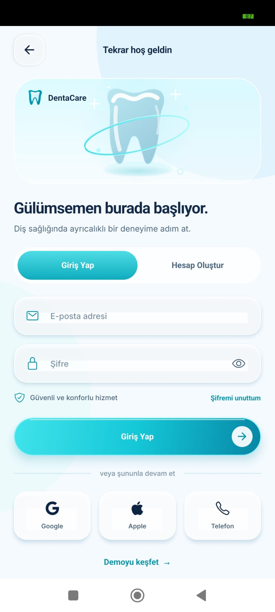</a></td>
    <td align="center"><a href="docs/images/baslangic-ihtiyaclar.jpg">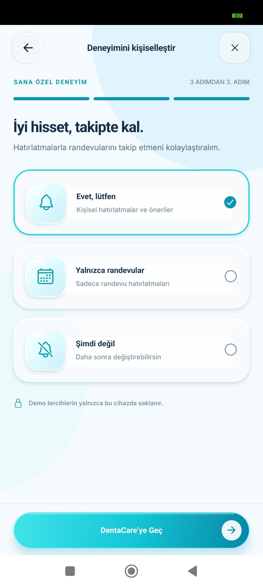</a></td>
    <td align="center"><a href="docs/images/baslangic-gorusme.jpg">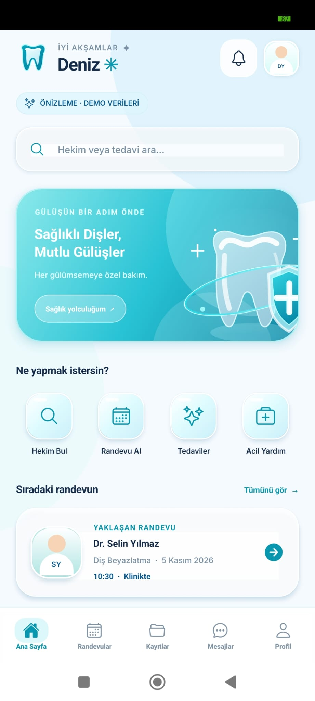</a></td>
  </tr>
  <tr>
    <td align="center">Hesap arayüzü</td>
    <td align="center">Çoklu seçim</td>
    <td align="center">Klinik veya görüntülü</td>
  </tr>
</table>

<table>
  <tr>
    <th align="center">Bildirimler</th>
    <th align="center">Keşif</th>
    <th align="center">Profil</th>
  </tr>
  <tr>
    <td align="center"><a href="docs/images/baslangic-bildirimler.jpg"></a></td>
    <td align="center"><a href="docs/images/kesif.jpg"></a></td>
    <td align="center"><a href="docs/images/profil.jpg">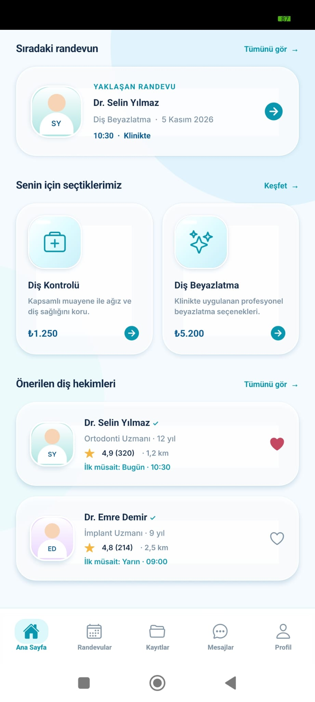</a></td>
  </tr>
  <tr>
    <td align="center">Hatırlatma tercihleri</td>
    <td align="center">Tedaviler ve hekimler</td>
    <td align="center">Hesap ve tercihler</td>
  </tr>
</table>

</details>

<details>
<summary><strong>Açılış, tamamlanan randevu ve sohbet ekranlarını göster</strong></summary>

<table>
  <tr>
    <th align="center">Açılış</th>
    <th align="center">Tamamlanan ziyaret</th>
    <th align="center">Sohbet</th>
  </tr>
  <tr>
    <td align="center"><a href="docs/images/splash.jpg">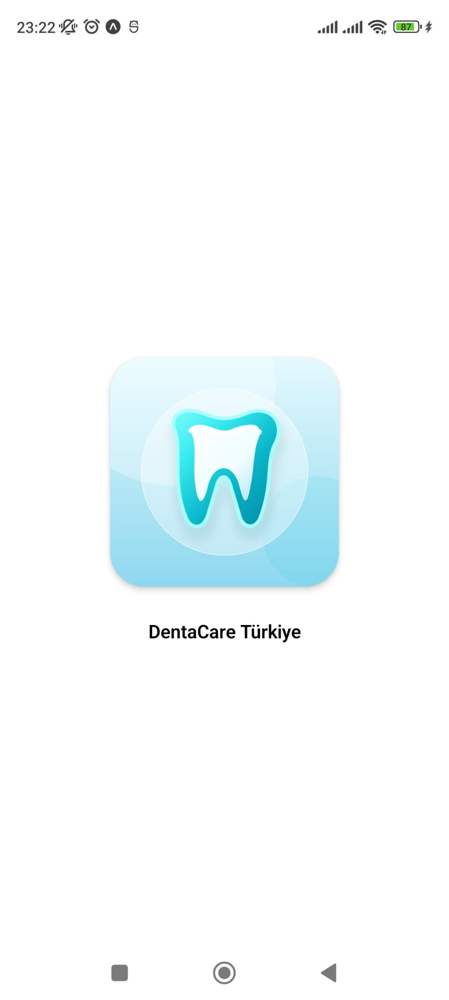</a></td>
    <td align="center"><a href="docs/images/tamamlanan-randevular.jpg">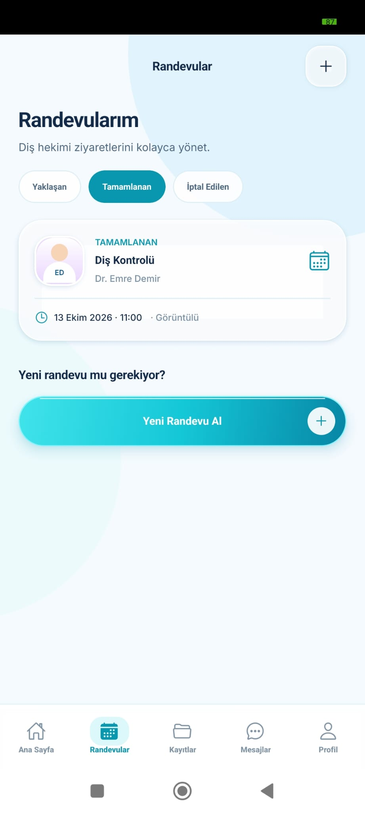</a></td>
    <td align="center"><a href="docs/images/sohbet.jpg">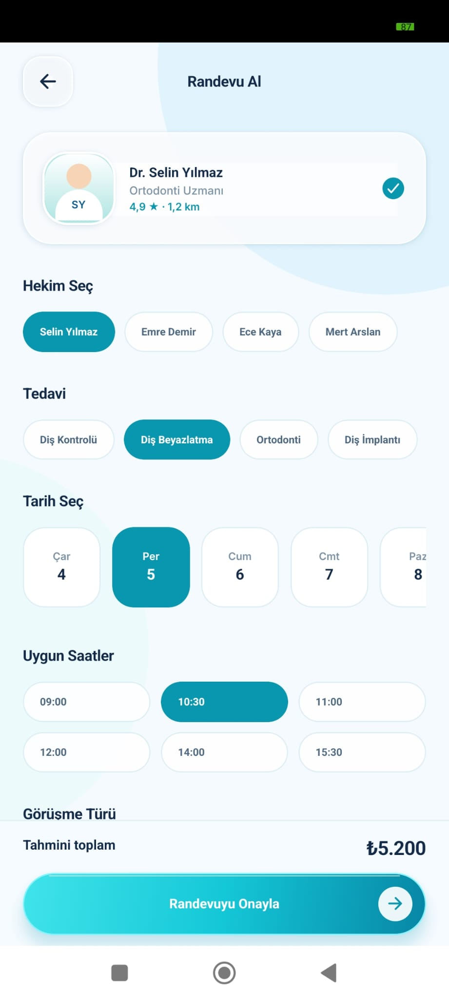</a></td>
  </tr>
  <tr>
    <td align="center">Native başlangıç ekranı</td>
    <td align="center">Randevu geçmişi</td>
    <td align="center">Klavye açık görünüm</td>
  </tr>
</table>

</details>

<sub>Ekran görüntüleri Android cihazdan alınmıştır ve kurgusal demo verileri içerir. Kapaktaki cihaz çerçeveleri sunum amaçlıdır; iOS üzerinde doğrulama yapıldığını belirtmez.</sub>

## Tasarım yaklaşımı

| Katman | Görsel karar |
| --- | --- |
| Renk | Buz mavisi arka planlar, turkuaz vurgu ve koyu metinler |
| Yüzey | Cam efektli kartlar, yumuşak gölgeler ve katmanlı paneller |
| Tipografi | Inter ailesi; başlık, açıklama ve eylem için belirgin hiyerarşi |
| Bileşenler | Yuvarlatılmış kartlar, kapsül butonlar ve tekrar kullanılan seçim alanları |
| Yerelleştirme | Türkçe metinler, `tr-TR` tarih biçimi ve temsili ₺ fiyatlar |

## Kurulum — Windows / VS Code

**Gereksinimler:** Node.js **22.13 veya üstü**, npm, VS Code ve ilk `npm install` işlemi için internet. Android için Expo Go veya açık Android Studio emülatörü.

1. Depoyu klonlayın veya GitHub üzerindeki **Code → Download ZIP** seçeneğiyle indirin.
2. VS Code’da `package.json` bulunan proje klasörünü açın.
3. **Terminal → New Terminal** bölümünden aşağıdakileri çalıştırın:

```powershell
node -v
npm install
npx expo start --clear
```

4. Terminalde `a`: Android emülatörü, `w`: web, QR kodu: Expo Go.
5. İlk açılışta native logo → animasyonlu Splash → **Hoş Geldin** ekranı açılır. **Hemen Başla** ile 3 adımlı başlangıç akışına veya **Zaten hesabım var** ile örnek giriş ekranına geçebilirsiniz.

**Bağlantı sorunu:** Telefon ve bilgisayar aynı Wi-Fi üzerinde olmalıdır. Gerekirse:

```powershell
npx expo start --tunnel
```

**Bağımlılık uyuşmazlığı:** `npx expo install --fix` ve ardından `npx expo start --clear` deneyin.

**Windows otomatik başlatma:** `START_WINDOWS.bat` kullanılabilir.

## Uygulama ekranları

| Bölüm | Ekranlar |
| --- | --- |
| Açılış | Splash, Hoş Geldin |
| Hesap | Giriş Yap / Hesap Oluştur, 3 adımlı başlangıç |
| Keşif | Ana Sayfa, Diş Hekimi Bul, Hekim Profili, Tedaviler, Tedavi Detayı |
| Randevular | Randevu Al, Randevu Onayı, Randevularım |
| İletişim | Görüntülü Görüşme, Mesajlar / Sohbet |
| Sağlık | Diş Sağlığı Kayıtları, Ağız Sağlığı Takibi, Acil Diş Sağlığı |
| Diğer | Klinik, Ödeme, Bildirimler, Favoriler, Profil, Tasarım Sistemi |

## Türkçe yerelleştirme

- Türkiye dili: **`tr-TR`**.
- Tarih: **`5 Kasım 2026`** tarzı, saat: **`14:30`** biçimi.
- Fiyat: **Türk lirası (₺)**. Fiyatlar gerçek klinik tarifesi veya döviz kuru dönüşümü değil, temsili demo değerleridir.
- Hekim, klinik ve kullanıcı isimleri: kurgusal Türkçe örnekler.
- Dahili rotalar ve durum anahtarları (`Upcoming`, `In-Clinic`, vb.) yazılım uyumluluğu için korunur; kullanıcıya görünen adlar Türkçedir.
- Yerel demo depolaması `dentacare.demo.tr.v3` anahtarını kullanır; İngilizce demo verileriyle karışmaz.

## Kaynak kod yapısı

```text
DentaCare_Premium_TR/
├── app/                  # Expo Router ekranları (Türkçe içerik)
│   ├── (auth)/           # Karşılama, giriş, başlangıç
│   ├── (tabs)/           # Ana sayfa, randevular, kayıtlar, mesajlar, profil
│   ├── dentists/         # Hekimler
│   └── treatments/       # Tedaviler
├── src/
│   ├── components/       # Tekrar kullanılan premium bileşenler
│   ├── context/          # Yerel örnek veriler ve durum yönetimi
│   ├── data/             # Türkçe hekim/tedavi/randevu örnek verileri
│   └── theme/            # Renkler, tipografi ve boşluklar
├── assets/               # Uygulama ikonları ve açılış görselleri
├── docs/                 # Türkçe mimari/tasarım notları
└── design-reference/     # Tasarım görselleri ve Türkçe ekran kataloğu
```

## Geliştirme kontrolleri

```powershell
npm run verify:structure
npm run verify:syntax
npm run verify:locale
npm run typecheck
```

İlk üç komut kaynak yapısını ve sözdizimini kontrol eder. `npm run typecheck` için önceden `npm install` yapılmalıdır.

## Önemli: Canlı sağlık hizmeti değildir

Bu proje **ön yüz ve etkileşimli demo** niteliğindedir. Gerçek hesap oluşturma, hasta kayıtları, klinik randevu hizmeti, acil yardım yönlendirmesi, canlı görüntülü görüşme, ödeme tahsilatı ve sunucu/veritabanı bağlantıları mevcut değildir. Uygulama örnek işlemleri cihazda simüle eder. **Gerçek hasta verisi veya ödeme bilgisi girmeyin.** Üretim kullanımı için kimlik doğrulama, yetkilendirme, KVKK değerlendirmesi, güvenli API, veri saklama, denetim, test ve erişilebilirlik çalışmaları gereklidir.

Ek belgeler: `docs/MIMARI.md`, `docs/TASARIM_SISTEMI.md`, `docs/EKRAN_AKISLARI.md`, `docs/UYGULAMAYA_ALMA.md`.


## Teknik belgeler

| Belge | İçerik |
| --- | --- |
| [Mimari](docs/MIMARI.md) | Proje katmanları ve durum yönetimi |
| [Tasarım sistemi](docs/TASARIM_SISTEMI.md) | Görsel dil ve bileşen kuralları |
| [Ekran akışları](docs/EKRAN_AKISLARI.md) | Sayfalar ve gezinme |
| [Uygulamaya alma](docs/UYGULAMAYA_ALMA.md) | Üretime hazırlık notları |

## Geliştirme yönü

Aşağıdaki maddeler tamamlanmış özellikler değil, sonraki geliştirme önerileridir.

- [ ] Gerçek kimlik doğrulama ve güvenli kullanıcı oturumları
- [ ] Klinik API’siyle müsaitlik sorgulama ve randevu eşitleme
- [ ] İzinlere bağlı bildirimler ve randevu hatırlatmaları
- [ ] Yetkilendirilmiş belge yükleme ve güvenli kayıt erişimi
- [ ] Canlı mesajlaşma ve görüntülü görüşme entegrasyonu
- [ ] Ekran okuyucu, yazı boyutu ve renk kontrastı kontrolleri
- [ ] Android ve iOS üzerinde uçtan uca akış doğrulaması

---

<p align="center"><strong>DentaCare Türkiye</strong><br>Her gülümsemeye özel bir deneyim.</p>
